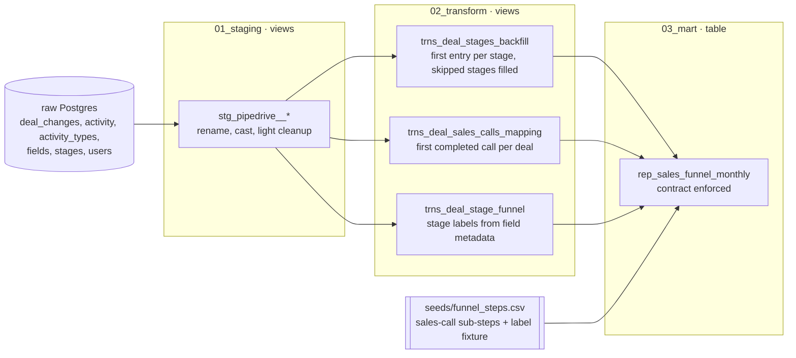

# Pipedrive sales funnel

A dbt project that turns the raw Pipedrive CRM export into
`rep_sales_funnel_monthly`: how many deals reached each of the 11 funnel steps,
by month.

The source has no `deals` table. Every deal-level fact comes from
`deal_changes`, which is Pipedrive's deal flow (`GET /deals/{id}/flow`), a log
of field updates per deal. [analyses/findings_and_approach.md](analyses/findings_and_approach.md)
has the entity map and the data-quality findings that shaped the models.

## Run it

```bash
docker compose up -d          # Postgres on :5432, admin/admin, loads raw_data/
pip install -r requirements.txt
dbt deps
dbt seed && dbt build         # 8 models, 1 seed, 35 tests
```

Results land in `pipedrive_staging`, `pipedrive_transform` and `pipedrive_mart`.

The four proposed reports in `analyses/additional_rep_models/` are not part of
the build. Run one with `dbt compile --select <name>` and execute the compiled
SQL.

## Layers



| Layer | Contains |
|---|---|
| `01_staging` | One view per raw table. Renames, casts, nothing else. Sources and column docs in `_pipedrive__sources.yml`. |
| `02_transform` | The logic worth isolating: first time each deal reached each stage, first completed sales call per deal, stage labels parsed from `fields.field_value_options`. |
| `seeds/funnel_steps.csv` | The 11 KPI steps. Supplies the two sales-call sub-steps, and acts as the expected-value fixture for the stage-label test. |
| `03_mart` | The deliverable. |

Layer prefixes (`stg_`, `trns_`, `rep_`) and numbered folders are a house
convention rather than dbt's `int_`/`fct_` naming. Leading commas are a second
deliberate deviation from the [dbt style guide](https://docs.getdbt.com/best-practices/how-we-style/2-how-we-style-our-sql).
Both are applied consistently across every file.

## Decisions worth knowing

**Every funnel step is measured on stage entry.** Pipedrive's
[Deal Progress](https://support.pipedrive.com/en/article/insights-reports-deal-progress)
report locks its date filter to "date of entering stage". Deal creation is the
[Deal Conversion](https://support.pipedrive.com/en/article/insights-reports-deal-conversion)
report's clock, and mixing the two inside one `deals_count` column would break
the report this model replicates. So step 1 counts deals entering Lead
Generation, not deals created. On real data the two coincide, because Pipedrive
places a deal in a stage the moment it is created.

**Skipped stages are backfilled.** A deal moving from stage 2 to stage 5 counts
as entering 3 and 4 as well, matching Deal Progress. Without it those two stages
undercount. Pipedrive represents a deal at its most recent stage after a
backward move; this model keeps the first time each stage was reached. No
genuine backward moves exist in this dataset, so the two agree here.

**Stage labels come from `fields.field_value_options`, not from the seed.**
Reordering stages is unlikely; adding or removing one is not. Reading the live
field metadata means a new stage reaches the report immediately, with
`assert_seed_matches_source_stage_labels` failing until the seed catches up. A
seed-driven design would leave that stage missing from the funnel until someone
edited a CSV, and a funnel quietly dropping a stage is worse than one carrying
an extra row. The trade: a new stage appears before anyone agrees it belongs,
labelled with whatever was typed into Pipedrive. The seed's stage rows are the
expected-value fixture that test asserts against, not a second definition of the
funnel. The seed owns the two sales-call sub-steps outright, since Pipedrive has
no source for them.

**Stages and sales calls are parallel KPIs, not a chain.** Only 8 deal ids of
4,572 appear in both `activity` and `deal_changes`, and one of those reached
stage 4 before its supposed prerequisite call was scheduled.

**`activity.due_to` stands in for a completion timestamp.** The source has none.
Production should use `done` with `updated_since` from the
[Activities API](https://developers.pipedrive.com/docs/api/v1/Activities).

**`deal_changes.new_value` is polymorphic text.** Its type depends on
`changed_field_key`, so every read casts explicitly.

## Testing

`dbt build` runs 35 tests. Most are generic: `not_null`, `unique`,
`accepted_values`, plus `dbt_utils.unique_combination_of_columns` and
`expression_is_true` for grain and range checks. Three singular tests cover what
a generic test cannot express.

| Test | Checks |
|---|---|
| [`assert_deal_stages_backfill_no_gaps`](tests/assert_deal_stages_backfill_no_gaps.sql) | Each deal's reached stages form a contiguous run from 1 to its highest stage. This is the invariant the backfill exists to guarantee. |
| [`assert_seed_matches_source_stage_labels`](tests/assert_seed_matches_source_stage_labels.sql) | The seed's stage labels still match Pipedrive's field metadata. |
| [`assert_every_deal_has_add_time`](tests/assert_every_deal_has_add_time.sql) | Every deal in `deal_changes` has an `add_time` event, which the proposed cohort report depends on. |

## Not built

Pipedrive defines four Insights report types on deals. One is delivered.

| Report | Status |
|---|---|
| [Deal Progress](https://support.pipedrive.com/en/article/insights-reports-deal-progress) | Delivered as [`rep_sales_funnel_monthly`](models/03_mart/rep_pipedrive/rep_sales_funnel_monthly.sql). |
| [Deal Conversion](https://support.pipedrive.com/en/article/insights-reports-deal-conversion) | Proposed: [`rep_sales_funnel_cohort_conversion`](analyses/additional_rep_models/rep_sales_funnel_cohort_conversion.sql). |
| [Deal Duration](https://support.pipedrive.com/en/article/insights-reports-deal-duration) | Proposed: [`rep_deal_stage_duration_monthly`](analyses/additional_rep_models/rep_deal_stage_duration_monthly.sql). |
| [Deal Performance](https://support.pipedrive.com/en/article/insights-reports-deal-performance) | Not attempted. No won/lost signal exists: `lost_reason` is set on all 1,995 deals. |

Conversion and Duration cover stages 1 to 9 but cannot include the two
sales-call sub-steps, because a call cannot be attributed to a `deal_changes`
cohort across two barely-overlapping id spaces. Two further reports are proposed
on the same basis:
[`rep_deal_ownership_by_stage`](analyses/additional_rep_models/rep_deal_ownership_by_stage.sql)
and [`rep_lost_reason_by_stage`](analyses/additional_rep_models/rep_lost_reason_by_stage.sql).

[analyses/stakeholder_demo.md](analyses/stakeholder_demo.md) shows all five
against the current data, written for a non-technical reader.
