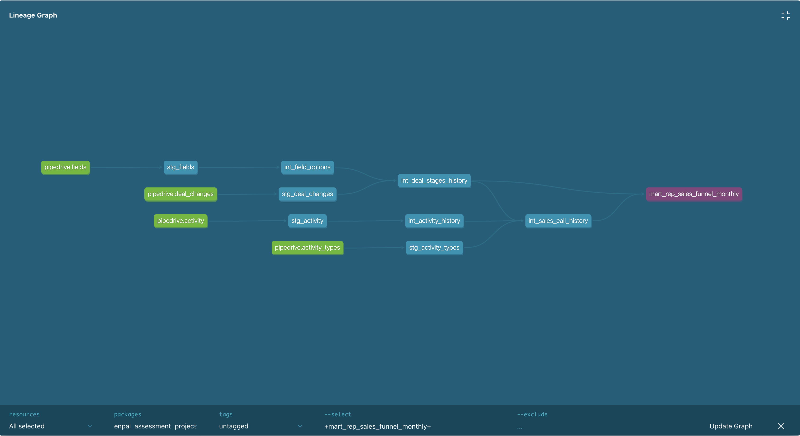
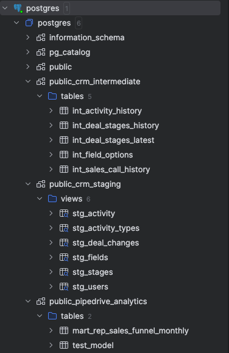
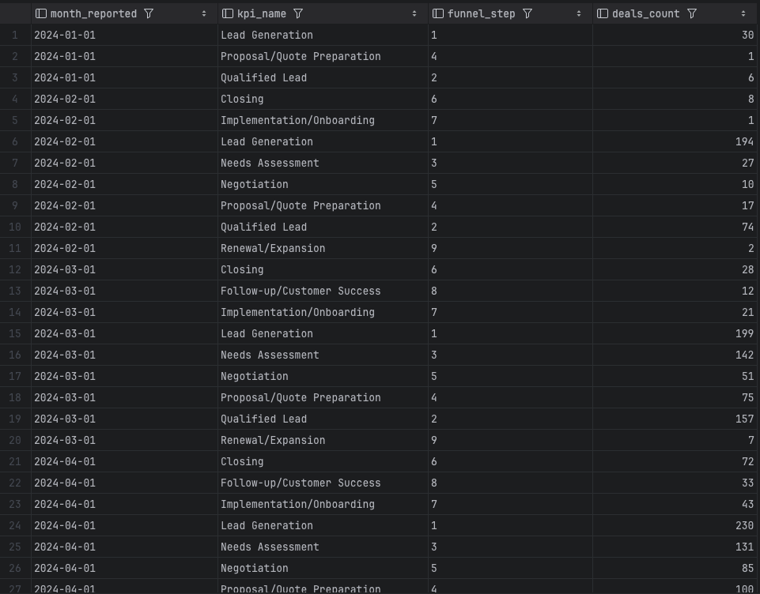

# Enpal CRM Analytics DBT Model

## Overview

This projects builds a clean, scalable, documented and analysis ready CRM analytics datasets using dbt.

Main Principles:
1) Three layer modelling: staging -> intermediate -> marts
2) Centralized test and documentation for scalibility and reusability.

## Project Structure

```
models/
  crm/
    staging/        # Source aligned, basic transformations (views)
    intermediate/   # Implemented business logics (tables)
    marts/          # Reporting ready datasets (tables)
  documentation/
    documentation_crm.md
```

## dbt Configuration

```yaml
crm:
  staging:
    +schema: crm_staging
    +materialized: view
  intermediate:
    +schema: crm_intermediate
  mart:
    +schema: crm_marts
    +materialized: table
```

### Layer Details

1) Staging:
    * 1:1 with sources, basic transformations (column renaming, data type changing)
    * Created as **views** to avoid duplication, ensure freshness
    Views:
    1) stg_activity_types
    2) stg_activity
    3) stg_deal_changes
    4) stg_fields
    5) stg_stages
    6) stg_users


2) Intermediate:
    * Implemented complex business logics
    * Created as **tables** to optimize for queries.
    Tables:
    1) int_activity_history
    2) int_deal_stages_history
    3) int_deal_stages_latest    
    4) int_field_options
    5) int_sales_call_history

  
3) Marts:
    * Reporting ready analytics dataset for users
    * Created as **tables** for better performance
    Tables:
    1) mart_rep_sales_funnel_monthly


## Incremental Models

Two intermediate tables use incremental data load:

1) int_activity_history
2) int_deal_staging_history

* `incremental_strategy='merge'` → threshold_days parameter used to determine lookback days.
Defined unique keys will be updated if there is any change, new rows will be appended with this incremental logic


## Documentation & Testing

1) Centralized column descriptions in `models/documentation/documentation_crm.md`
2) Each layer has a YAML file with:
  a. Models description
  b. Columns description (referencing centralized doc)
  c. Tests: `not_null`, `unique`
3) Ensures consistency, integrity, and governance
4) dbt Documentation & Lineage: 
  By running following commands:
  - dbt docs generate 
  - dbt docs serve 
  You can view the full documentation, tests, and model lineage in an interactive interface.
  This will allow to
  - Explore each model and column descriptions
  - Visualize the dependency graph and how data flows from sources → staging → intermediate → marts
  
  

## Next Steps
1) Ready to extend for additional domains.
2) Ready to add new marts for any reporting needs.
3) User emails are open, should be masked for GDPR complience.

**END OF DOCUMENTATION**


Assignment Notes:
All models are created and tested in local postgres database.
Intermediate model must be created as full refresh in the inital run.

Local postgres structure: 



Sample output from Marts:

