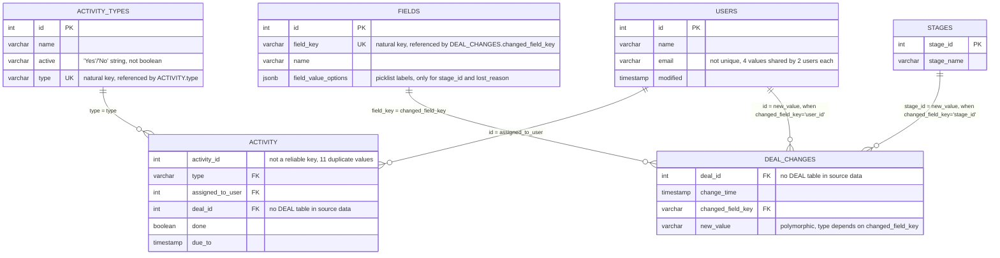

# Findings and approach

Source data model, the decisions it forced, and what I would do next. The
queries behind every number here are in
[pipedrive_data_assessment.sql](pipedrive_data_assessment.sql).

## Source data model

Six raw tables from `raw_data/*.csv`. Keys and relationships were checked
against the loaded data, not assumed from the column names.

### Keys at a glance

| Table | Primary key | Foreign keys | Notes |
|---|---|---|---|
| `activity_types` | `id` | – | `type` acts as a second, natural key |
| `activity` | none declared | `type` → `activity_types.type`, `assigned_to_user` → `users.id`, `deal_id` → *(missing)* | `activity_id` is not unique (11 dupes) |
| `deal_changes` | none declared | `changed_field_key` → `fields.field_key`, `new_value` → `stages.stage_id` or `users.id` (conditional), `deal_id` → *(missing)* | EAV-style log, grain is one row per field change |
| `fields` | `id` | – | `field_key` is the natural key referenced elsewhere |
| `stages` | `stage_id` | – | 9 rows, one per funnel stage |
| `users` | `id` | – | `email` is not unique |

## Data quality notes

**`deal_changes` is the deal flow endpoint, and flow only logs changes.** It
corresponds to [`GET /deals/{id}/flow`](https://developers.pipedrive.com/docs/api/v1/Deals).
A deal that is created in a stage and never moves produces no `stage_id` record
at all, so a funnel built from flow alone drops it silently. Pipedrive's own
developer community answer is to read the flow for movement and fall back to
`GET /deals/{id}` for current stage. This dataset hides the problem, because
every deal here carries an explicit `stage_id = 1` event. Real data will not.

**Five deal ids each hold two deals.** Ids 399956, 554294, 556338, 851850 and
955417 carry two independent event streams apiece. The generator gives every
deal a fixed time-of-day: 1,990 deals show exactly one time-of-day across all
their events, these five show exactly two, and each group is a complete deal
with its own `add_time`, its own `user_id`, a monotonic stage run starting at 1,
and its own `lost_reason`.

This single artifact explains both oddities I found separately. The 5 "duplicate
`add_time`" deals and all 8 "backward stage moves" are the same five ids. No
deal was created twice and no deal moved backwards. `min(add_time)` and the
first-reached dedup merge each pair, which understates counts by at most 5 deals
in 1,995. I did not model around it: splitting on time-of-day would fit the
generator rather than Pipedrive.

**Deal creation and first stage entry sit 35 days apart, and should not.** Every
deal's events run `add_time` → `user_id` → `stage_id = 1`, always in that order.
The first stage event lands a median 35 days after creation (min 2, max 83) and
never before it. Consecutive stage moves are a median 16 days apart, so that gap
is roughly two ordinary steps of lag with a manufactured `user_id` event sitting
inside it. Pipedrive places a deal in a stage when it is created, so on real data
the two timestamps coincide. The gap is generated, and so is the drift it
implies.

Consequence for the model: step 1 counts deals entering Lead Generation, which
is what [Deal Progress](https://support.pipedrive.com/en/article/insights-reports-deal-progress)
measures. Deal creation belongs to
[Deal Conversion](https://support.pipedrive.com/en/article/insights-reports-deal-conversion),
a different report on a different clock. I did not add a "Deal Created" step
ahead of Lead Generation, because on real data it would duplicate step 1.

**No `deals` table exists, and the two `deal_id` spaces barely intersect.** Both
`activity.deal_id` and `deal_changes.deal_id` point at an entity that is not in
the source. Only 8 ids appear in both, out of 4,572 distinct ids in `activity`
and 1,995 in `deal_changes`.

**`deal_changes.new_value` is polymorphic.** Its type and referenced table
depend on `changed_field_key`. `stage_id` values reference `stages.stage_id`,
`user_id` values reference `users.id`, while `add_time` and `lost_reason` are
timestamp text and a picklist code. All checked values resolved with 0 orphans.

**`stages.stage_name` and `fields.field_value_options` disagree on casing.**
Stage 2 is "Qualified lead" in one and "Qualified Lead" in the other.

**`activity.activity_id` is not a safe unique key.** 11 duplicate values out of
4,579 rows, 0.24%. Deduplicate before treating it as a primary key.

**`change_time` runs to 2025-03-11, `due_to` only to 2024-09-13.** Deals created
or updated after October 2024 have no activity records in this window.

**`activity_types.type` codes do not match their names.** `meeting` maps to
"Sales Call 1" and `sc_2` maps to "Sales Call 2".

**`activity.due_to` is a due date, not an activity date.** Production should
combine `done` with `updated_since` from the
[Activities API](https://developers.pipedrive.com/docs/api/v1/Activities). This
exercise uses `due_to` as a proxy.

**`lost_reason` is set on all 1,995 deals**, regardless of outcome, and which
reason a deal gets shows no relationship to the stage it was lost from.

## Approach and conclusions

### Scope

Four tables build the funnel: `activity`, `activity_types`, `deal_changes` and
`fields`. Together they reconstruct it without a dedicated deals table. A
production model should read the [Deals API](https://developers.pipedrive.com/docs/api/v1/Deals)
directly instead of rebuilding deal state from a changelog.

`stages` and `users` stay out. `stages` duplicates
`fields.field_value_options`, and `users` supports no part of this use case,
though it would support a breakdown by sales rep later. Both are still declared
as sources so the next person can see what the export contains.

### Business context and assumptions

The brief gives little context, so I inferred the use case from Pipedrive's own
knowledge base and API docs. Pipedrive defines
[four Insights report types on deals](https://support.pipedrive.com/en/category/progress/insights-reports):
Performance, Conversion, Duration and Progress.

- The required model maps to **Progress**, which shows deals moving through
  stages within a time frame. It is the only report built into the data model,
  and it covers the full 11-step funnel the brief asks for.
- **Conversion** (fixed cohort by creation date, cumulative reach per stage) and
  **Duration** work for the 9 pipeline stages but cannot extend to the two
  sales-call sub-steps. With 8 of 4,572 ids overlapping, a call's completion
  cannot be attributed to a `deal_changes` cohort at any real scale. Duration
  has a second problem: a sales call is a point event, not a state a deal dwells
  in, so "days spent in Sales Call 1" is not a coherent metric. Both are written
  as runnable SQL in `analyses/` for review rather than built, so neither is
  presented as satisfying the brief's combined funnel.
- **Performance** was not attempted. No won/lost flag exists anywhere in the
  source, and `lost_reason` cannot stand in for one.

### Funnel steps: stages vs activities

The brief asks for a combined funnel of 9 stages and 2 activities. Only 8 of
1,995 deals have both an activity and a `deal_changes` record under the same
`deal_id`, so no dependency chain between them can be verified at scale, and the
little that can be checked contradicts one: a deal reached stage 4 before its
supposed prerequisite call was even scheduled. The model treats stages and
activities as independent parallel KPIs.

### Materialisation strategy

With the raw data in the same database, staging and transform can both stay
views, as long as no other use case needs the raw Pipedrive tables analysed
directly. If one appears, materialise the staging layer so analysts can explore
the source on its own. That matters more once raw data moves out of this
database into S3 or GCS, where analysts cannot reach it easily.

Pipedrive's API endpoints correspond to the csv files provided here. When
ingestion moves to those endpoints, a raw layer should exist to re-run pipelines
from, given the API's rate limits. Working assumption for this exercise: the raw
csv is that layer, so staging and transform can run as views.

### Recommendations

**Business**

1. Add Conversion and Duration
   (`additional_rep_models/rep_sales_funnel_cohort_conversion.sql`,
   `additional_rep_models/rep_deal_stage_duration_monthly.sql`) so the team can
   compare conversion rates by cohort and see where deals stall.
2. Decide what the sales calls are. If they gate movement to the next stage,
   drop them from the funnel view. If they do not, report them as a share of a
   stage ("x% of Qualified Leads received Sales Call 1") rather than as steps of
   their own. Activities are point-in-time events, and Pipedrive
   [recommends keeping them in their own report](https://support.pipedrive.com/en/article/insights-reports-activities-performance).
3. Track won and lost at deal level, so funnel patterns can be split by outcome.
   That also unlocks the
   [Performance report](https://support.pipedrive.com/en/article/insights-reports-deal-performance).
4. Use `lost_reason` operationally once it is trustworthy. "Customer Not Ready"
   is a reactivation trigger.

**Technical**

1. Ingest the deal entity, so `deal_changes` and `activity` can join on a real
   deal set instead of colliding in an unrelated id space.
2. When reconstructing stage history from the flow endpoint, fall back to
   `GET /deals/{id}` for deals with no `stage_id` record. Otherwise every deal
   that never moved stage disappears from the funnel.
3. Establish a raw layer for everything loaded from the API, to avoid reloads,
   and settle the materialisation strategy there.
4. Move from table to incremental if volume grows. `deal_changes` and `activity`
   are the candidates.
5. Give consumers a sort key. `funnel_step` is text, so a BI tool sorts
   1, 2, 2.1, 3 by accident of lexicographic ordering and breaks at a tenth
   step. `funnel_steps.csv` already carries `step_order`; a consumer should join
   it, and it should become a column on the mart once the brief's four-column
   constraint no longer applies.
6. Build SCD2 on the lookup tables `activity_types`, `fields` and `users` to
   keep their history. This becomes necessary when ingestion moves from a
   one-off csv import to the API. It adds complexity this exercise does not
   need.
7. If Conversion or Duration are approved, promote them into `models/03_mart/`
   with a schema.yml entry and the `dbt_utils` tests they need, including a
   monotonicity check on `conversion_pct`.
